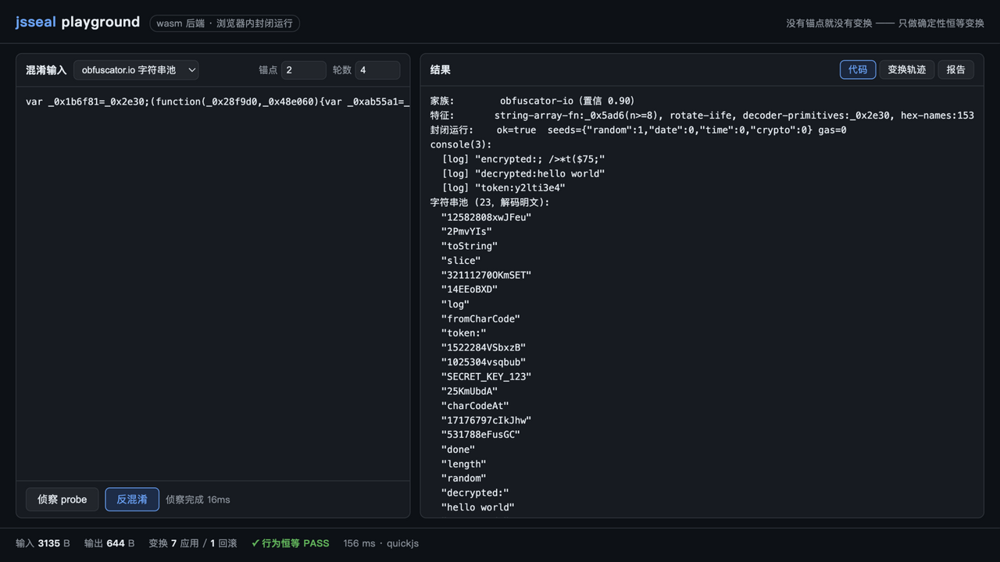

# jsseal — 确定性封闭运行时 JS 反混淆器

> **核心原理（一句话）**：反混淆的本质是等价改写，而程序等价性不可判定；
> jsseal 在引擎级封闭一切非确定性（随机/时间/网络/时钟），把任意混淆程序
> 连同环境变成**可重放的确定性纯函数**，从而把不可判定的等价性问题变成
> 可机器验证的逐位比对——**每个变换都必须证明自己没有改变任何可观测行为，
> 证明不了就回滚。没有锚点就没有变换。**

```bash
npm install && npx tsc -b && bash engine/build.sh && npm test
node packages/cli/dist/index.js probe samples/obfuscator-io.js
node packages/cli/dist/index.js samples/obfuscator-io.js -o out.js --report r.json
```

**浏览器演练场**（wasm 后端，完整管线在浏览器内运行）：

```bash
npm run -w @jsseal/web start    # 构建 + 本地服务 → http://127.0.0.1:8642
```



```bash
npm install && npx tsc -b && bash engine/build.sh && npm test
node packages/cli/dist/index.js probe samples/obfuscator-io.js
node packages/cli/dist/index.js samples/obfuscator-io.js -o out.js --report r.json
```

**浏览器演练场**（wasm 后端，完整管线在浏览器内运行）：

```bash
npm run -w @jsseal/web start    # 构建 + 本地服务 → http://127.0.0.1:8642
```

## 文档

| 文档 | 内容 |
|---|---|
| [CLI 指南](docs/CLI-GUIDE.md) | 命令/选项/报告字段/常见工作流 |
| [方法论原理](docs/PRINCIPLES.md) | 环境封闭/锚库验证/恒等变换/污点传播 |
| [构建指南](docs/BUILDING.md) | 多平台构建/引擎架构/排障 |
| [插件体系](docs/PLUGINS.md) | 变换插件 API/LLM Provider/测试指南 |
| [架构日志](docs/ARCHITECTURE.md) | 28 节实现记录 + 全部踩坑 |
| [AI Agent 指南](AGENTS.md) | 面向 AI 的使用说明 |
| [贡献指南](CONTRIBUTING.md) | 开发纪律/变换开发规则/测试要求 |
| [变更日志](CHANGELOG.md) | 版本历史 |

## 实战成绩（4 个样本全部 ✅，3 个来自真实野外）

| 样本 | 家族 | 大小变化 | 还原效果 |
|---|---|---|---|
| synchrony 官方 obfuscator-io.js | obfuscator.io | 20K→8.4K (-59%) | 字符串池明文+hex 名还原 |
| jsfuck.js（编码器生成全编码） | JSFuck | 3.0K→24B (-99%) | `console.log(1234567890)` 明文 |
| sojsonv7/sample_189.js | sojson v7 (jsjiami) | **101K→41B (-99.96%)** | 完整业务逻辑（2 行） |
| jsconfuser/control-flow-flattening.js | jsconfuser | 10K→3.2K (-69%) | CFF 状态机还原+业务语句可见 |

## 支持矩阵

| 家族 | 状态 |
|---|---|
| obfuscator.io 全配置 | ✅ |
| sojson v5–v7 / jsjiami | ✅ |
| jsconfuser / js-confuser（含状态机 CFF） | ✅（2.1.3 动态 case 🔶） |
| packer / eval 链 / ctor 链 | ✅ |
| 动态 CFF（运行时执行序） | ✅ |
| JSFuck 全编码（[]()!+ 原子折叠） | ✅ |
| JSVMP 虚拟化 | ❌ |

## 架构

```
engine/quickjs/   引擎 fork（种子磁带/虚拟时钟/gas/trace/污点/分支强制）
packages/
  engine-native/  native 引擎绑定（默认后端）
  runtime/        封闭内核（sealing prelude + 三后端）
  anchors/        锚库（行为恒等 + 健康哨兵 + 分支指纹迁移）
  detector/       家族识别 + 三件套提取
  transforms/     20 个内置恒等变换（+ 可选 LLM 重命名）
  core/           governor（验证循环/提交回滚）+ probe
  cli/            jsseal 命令行
  web/            浏览器演练场（单文件 bundle，wasm 内嵌）
```

## 核心能力

| 能力 | 实现 |
|---|---|
| 种子封闭 | Math.random/Date/performance/crypto → 录制/重放磁带（引擎级，guest 不可觉察） |
| 虚拟时钟 | setTimeout/Promise/rAF 确定性调度（异步样本可封闭） |
| 网络 VCR | 确定性罐头响应 + fixture 注入 + netLog（锚库可观测） |
| gas 限额 | 确定性资源上限（同代码消耗逐位一致） |
| trace | call/sret/cret（实参+污点）/br/go 五类事件 + 白名单 |
| 分支强制 | 第 k 个执行的条件分支取反 + 指纹迁移（多路径覆盖） |
| LLM 重命名 | mock/openai/anthropic/ollama 四后端（"LLM only suggests names"） |
| 环境探针 | 缺失 API 自动报告（envMisses/netMisses/missingEnv 三条闭环） |

## 已知限制

- **单路径覆盖**：锚库只验证采样输入的执行路径（`--forced-branches` 部分缓解）
- **js-confuser ≥2.1 边界**：cff 动态 case 标签（已熔断保 PASS）、preset 的 dispatcher 间接化
- **JSFuck escape 扩展**：基本字符集（可达字母/数字/括号/`.`）✅；引号、反斜杠等需 escape 技巧的字符未覆盖
- **JSVMP**：领域公认空白
- **Windows native**：暂不支持（自动降级 wasm 后端）

## 安全须知

jsseal 处理的是**不可信代码**。虽然封闭运行时（QuickJS 沙箱 + 种子磁带 + gas 限额 +
网络 VCR）本身就是在隔离环境中执行样本，但仍建议：在容器/虚拟机中运行 CLI；
不要把 `--net-fixture` 里的真实凭据提交进仓库；`report.json` 可能包含样本解出的
明文（密钥、接口地址），公开分享前先脱敏。

## 许可

MIT
